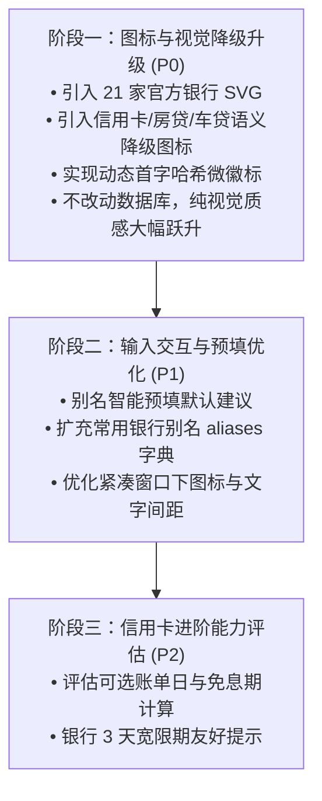

# 还款提醒视觉与体验优化方案：真实银行图标、无图标语义化降级与提醒能力增强

- 状态：方案设计已就绪，待评审（2026-11-10）
- 记录日期：2026-11-10（北京时间）
- 版本基线：`Cargo.toml` 当前 `0.6.1`，SQLite schema 当前为 v13
- 范围：对现已落地的「统一还款提醒」进行视觉质感与用户体验深度优化，重点解决当前银行图标为自制文本圆圈的问题、突破“无银行图标/未指定银行”时的粗糙降级展示，并吸收 GitHub 优秀还款开源项目的成熟交互设计。
- 一句话结论：从开源优质矢量库引入精简官方银行 SVG 替换自制文本徽标；对“未指定银行”和“其他银行”实施按账户类型（信用卡/房贷/车贷）及动态首字哈希的语义化降级；保持单 EXE 编译期嵌入与零网络隐私边界不变。

---

## 1. 背景与现状核查

### 1.1 现状与代码证据

在 `0.6.1` 版本中，项目已成功将单一的信用卡功能升级为包含信用卡、房贷、车贷的统一「还款提醒」架构：
- 领域模型 [`PaymentAccount`](file:///d:/GITHUB_melody0709/stock_new/src/finance/credit_card.rs#L18-L36) 支持三类账户、按月还款日、贷款结束月与已结清状态；
- 存储层完成 v12→v13 迁移，保持物理表兼容并支持复合身份去重；
- 调度层 [`src/finance/schedule.rs`](file:///d:/GITHUB_melody0709/stock_new/src/finance/schedule.rs) 实现了全账户多档提前提醒与逾期补提醒；
- 交互层 [`ui/main.slint`](file:///d:/GITHUB_melody0709/stock_new/ui/main.slint) 实现了折叠式编辑表单与还款卡片列表。

### 1.2 现有银行图标实现的问题

经过对当前代码的排查，当前的银行图标展示存在明显的视觉与体验短板：

1. **图标均为程序化自制文本徽章，非真实银行 Logo**：
   - 查看 [`assets/banks/SOURCES.md`](file:///d:/GITHUB_melody0709/stock_new/assets/banks/SOURCES.md#L5-L10)，目录下的 22 个 SVG 图标均为开发期脚本生成的圆形徽章：
     ```xml
     <svg xmlns="http://www.w3.org/2000/svg" viewBox="0 0 96 96">
       <circle cx="48" cy="48" r="44" fill="#c7000b"/>
       <circle cx="48" cy="48" r="38" fill="none" stroke="rgba(255,255,255,.55)" stroke-width="3"/>
       <text x="48" y="57" text-anchor="middle" font-family="Microsoft YaHei,sans-serif" font-size="26" font-weight="700" fill="white">工商</text>
     </svg>
     ```
   - 界面呈现的是粗糙的“红底白字圈”或“蓝底白字圈”，缺乏辨识度与桌面客户端的精致感。

2. **“未指定银行 / 没有银行图标”时的粗糙降级**：
   - 在 [`src/finance/bank.rs:126-156`](file:///d:/GITHUB_melody0709/stock_new/src/finance/bank.rs#L126-L156) 中，若 `id` 为 `None` 或未知，统一回退到 [`assets/banks/generic.svg`](file:///d:/GITHUB_melody0709/stock_new/assets/banks/generic.svg)（灰底白字“银行”）；选择“其他银行”时则回退到 [`assets/banks/other.svg`](file:///d:/GITHUB_melody0709/stock_new/assets/banks/other.svg)（同样是写着“银行”）。
   - **痛点**：当用户添加的是**房贷**或**车贷**，且选择“未指定银行”时，列表中依然显示一个写着“银行”二字的灰色小圆圈，语意脱节且无法通过图标区分账户类型。
   - 当用户自定义输入“盛京银行”或“厦门国际银行”时，所有自定义银行显示的图标完全一模一样，无个性化区分。

3. **银行匹配与选择的灵活性有限**：
   - 银行选择当前为单层 `ComboBox`（22 项），当后续需要支持更多常见地方城商行/农商行时，长列表滚动选择成本较高；
   - 别名未提供智能预填建议，用户每建一项都要手动重复键入名称。

---

## 2. GitHub 开源项目调研与业界优秀实践

针对上述痛点，对 GitHub 上的相关开源项目进行了深入调研，总结出以下可借鉴的技术资产与设计模式：

### 2.1 银行矢量图标开源资产

| 仓库名称 | 许可协议 | 资源特点 | 对本项目的价值 |
| :--- | :--- | :--- | :--- |
| **[icongo/bank-logos](https://github.com/icongo/bank-logos)** | **MIT** | • 包含 600+ 高清银行矢量 SVG Logo<br>• 涵盖全部中国大行、股份制银行、主流城商行及国际银行<br>• 标准 SVG，无多余脚本或外部依赖，体积极小（1~3 KB） | **核心图标库选型首选**。可直接提取 21 家主流银行的纯净官方矢量轮廓，无版权争议且轻量。 |
| **[cellier/bank-icon-cn](https://github.com/cellier/bank-icon-cn)** | 开源公开 | • 原 Ping++ 官方银行图标库<br>• 国内金融与支付类 App 的标杆资源<br>• 提供标准正方形图标与 Sketch 源文件 | 规范的方形视口与配色标准，可用于辅助规范视口与内边距。 |
| **[burningmyself/bank](https://github.com/burningmyself/bank)** | MIT | • 包含主流银行卡 Bin 规则与卡组织、银行代码映射 | 银行简称与全称的权威映射字典，可扩充我们的 `aliases` 列表。 |

### 2.2 信用卡与还款提醒相关开源项目

| 仓库名称 | 技术形态 | 核心功能与亮点 | 对本项目的借鉴思路 |
| :--- | :--- | :--- | :--- |
| **[woshichenghaibo/creditcards](https://github.com/woshichenghaibo/creditcards)**<br>*(信用卡掌柜)* | Serverless + D1 | • 专注多卡账单日、还款日及免息期追踪<br>• 实时计算最长免息期与当前卡片免息天数<br>• 微信推送提醒 | 引入**“可选账单日”**概念，为信用卡提供“剩余免息天数”信息，增加还款助手的实用价值。 |
| **[MateYou-Apps/DueDate](https://github.com/MateYou-Apps/DueDate)**<br>*(到期提醒)* | Android Compose | • 坚持 **离线优先（Offline-first）** 与本地数据隐私<br>• 灵活的多阶段提醒策略<br>• 区分全额已还与状态追踪 | 坚定本项目“不连网、不索要账单/卡号、纯本地存储”的安全定位。 |
| **[ajnart/subs](https://github.com/ajnart/subs)**<br>*(Wallos 周期账单)* | Web 仪表盘 | • 内置服务商预设图标，提供缺失图标时的色彩提取与通用图形兜底<br>• 临近账期阶梯式色标（绿/黄/红） | 列表项的紧急程度视觉反馈（例如到期当天显示醒目状态）。 |

### 2.3 业界在“无银行图标”时的最佳处理方案

通过分析金融科技和个人记账类开源项目，在“无特定银行图标”时有以下成熟设计：

1. **基于业务类型的语义化降级（Semantic Account Fallback）**：
   - 当没有银行 Logo 时，不显示冰冷的通用“银行”，而是显示该事项的本质属性：
     - **信用卡**：极简现代卡片轮廓（带有芯片或磁条剪影）；
     - **房贷**：温馨房屋剪影图标；
     - **车贷**：现代流线型汽车轮廓图标。
   - 用户在列表中哪怕不看文字，凭借第一眼视觉就能区分账单性质。
2. **确定性哈希动态首字徽标（Deterministic Monogram Avatar）**：
   - 类似 Google/Apple 账户头像机制：针对选择“其他银行”并手工输入自定义名称（如“盛京银行”、“桂林银行”）的情况；
   - 自动提取名称前 1~2 个汉字，通过字符串 Hash 从预设的高级莫兰迪色盘中选取底色，动态生成 SVG；
   - 保证相同名称每次渲染颜色一致，彻底消除“所有自定义银行都是灰色千篇一律”的廉价感。
3. **通用金融立柱/神殿矢量轮廓**：
   - 将“银行”文字圆圈升级为国际通用的金融机构建筑剪影（Pantheon/Bank outline），即使是通用降级也保持专业度。

---

## 3. 详细优化方案设计

### 3.1 优化模块一：银行真实矢量图标升级

#### 3.1.1 资源来源与处理
- 从 MIT 协议的 `icongo/bank-logos` 选取已登记的 21 家银行官方矢量 SVG；
- 对原始 SVG 进行无损清洗（SVG Clean-up）：
  - 统一视口为 `viewBox="0 0 96 96"`；
  - 规范圆角矩形或微徽章背景（底色遵循各银行官方 VI 识别色，如招行红 `#d80c18`、建行蓝 `#003b8e`、农行绿 `#008566` 等）；
  - 矢量图形位于中心并保留 12% 安全内边距（Padding），确保在 26px 表单图标和 32px 列表图标下均清晰锐利；
  - 移除无用元数据与 CSS 样式，单个 SVG 体积严格控制在 **1.2KB ~ 2.5KB** 之间。

#### 3.1.2 打包与发布约束
- 保持现有的 `include_bytes!` 机制直接编译进 EXE，**不新增运行时外部文件依赖**；
- 22 个优化后的 SVG 总增量不超过 50KB，对单 EXE 安装包和启动速度零影响；
- 保持现有 `assets/banks/SOURCES.md` 的更新，清晰记录每个 SVG 文件的来源、MIT 授权与设计规范。

---

### 3.2 优化模块二：“无银行图标”与“非银行类型”分层降级架构

#### 3.2.1 三级降级策略矩阵

将现有的单一 `bank_icon(id: Option<&str>)` 升级为具备上下文感知的层级降级体系：

```text
                  [获取还款图标上下文]
                (bank_id, account_kind, bank_name)
                           │
             ┌─────────────┴─────────────┐
             ▼                           ▼
      【有内置 bank_id】           【未指定银行 / other / 未知 ID】
             │                           │
    内置 21 家官方银行矢量?                 ├──────────────┬──────────────┐
       ├── 是 ──> 渲染官方银行 SVG         ▼              ▼              ▼
       └── 否 (other/未知)        【信用卡类型】    【房贷类型】    【车贷类型】
             │                           │              │              │
      用户输入了自定义名称?                 ▼              ▼              ▼
       ├── 是 ──> 动态首字哈希徽章      卡片矢量轮廓     房屋剪影矢量    汽车流线矢量
       └── 否 ──> 对应类型语义兜底
```

| 场景 | 当前表现 | 优化后设计 | 视觉呈现 |
| :--- | :--- | :--- | :--- |
| **指定了内置银行**（如工行/招行） | 纯文字圆圈（红底白字“工商”） | **官方标准矢量 SVG** | 品牌 VI 官方 Logo，专业精致 |
| **信用卡 · 未指定银行** | 灰底白字“银行” | **信用卡语义图标** (`kind_credit_card.svg`) | 优雅的极简银行卡片轮廓 |
| **房贷 · 未指定银行** | 灰底白字“银行” | **房贷语义图标** (`kind_mortgage.svg`) | 房屋剪影轮廓，一眼明了 |
| **车贷 · 未指定银行** | 灰底白字“银行” | **车贷语义图标** (`kind_auto_loan.svg`) | 现代汽车剪影轮廓 |
| **其他银行 · 输入了具体名称**（如“盛京银行”） | 灰底白字“银行” | **动态首字哈希微徽章** (Dynamic Monogram) | 提取“盛京”，配合名称 Hash 生成专属莫兰迪底色 |
| **其他银行 · 尚未输入名称** | 灰底白字“银行” | **通用金融立柱建筑剪影** (`bank_building.svg`) | 经典神殿立柱矢量，替代纯文字 |

#### 3.2.2 动态首字微徽标实现设计（Rust 渲染）
在 Rust 端增加一个轻量级的动态 SVG 生成函数，无需引入任何第三方图像库：

```rust
/// 为自定义银行名称动态生成 SVG 矢量徽章数据
pub(crate) fn generate_monogram_svg(name: &str) -> Vec<u8> {
    let clean = name.trim();
    let display_text: String = clean.chars().take(2).collect();
    // 使用稳定哈希从预设高级色盘中选取底色
    const PALETTE: &[&str] = &[
        "#3b82f6", "#0ea5e9", "#06b6d4", "#10b981", "#14b8a6",
        "#6366f1", "#8b5cf6", "#ec4899", "#f43f5e", "#f59e0b",
    ];
    let mut hash: usize = 0;
    for b in clean.bytes() {
        hash = hash.wrapping_mul(31).wrapping_add(b as usize);
    }
    let bg_color = PALETTE[hash % PALETTE.len()];
    
    format!(
        r#"<svg xmlns="http://www.w3.org/2000/svg" viewBox="0 0 96 96">
            <rect width="96" height="96" rx="24" fill="{bg_color}"/>
            <text x="48" y="58" text-anchor="middle" font-family="Microsoft YaHei,Segoe UI,sans-serif" font-size="28" font-weight="bold" fill="#ffffff">{display_text}</text>
        </svg>"#,
        bg_color = bg_color,
        display_text = display_text
    ).into_bytes()
}
```

---

### 3.3 优化模块三：还款提醒交互与体验增强

参考 `woshichenghaibo/creditcards` 与 `ajnart/subs`，在保持当前简洁输入的前提下，为用户带来显著的易用性提升：

#### 3.3.1 别名智能预填与建议（Smart Alias Autofill）
- **痛点**：用户在下拉中选择了“招商银行”，仍需手动在别名栏输入“招商信用卡”或“招行房贷”。
- **优化**：
  - 当别名输入框为空或未修改过时，切换银行或类型自动填充合理默认值：
    - 选择招商银行 + 信用卡 -> 自动预填「招商银行 信用卡」；
    - 选择建设银行 + 房贷 -> 自动预填「建行 房贷」；
  - 若用户已手动修改了别名，则不再强行覆盖，尊重用户自定义。

#### 3.3.2 银行简称别名匹配库扩展（Aliases Expansion）
- 在 [`src/finance/bank.rs`](file:///d:/GITHUB_melody0709/stock_new/src/finance/bank.rs) 的 `aliases` 中补充更多民间常见简称（如“工银”、“建融”、“交银”、“邮储银”、“招银”等）；
- 旧数据升级或粘贴导入时，容错率大幅提升。

#### 3.3.3 可选账单日与免息期提示（阶段二扩展建议）
- 借鉴 `creditcards` 的核心亮点：
  - 信用卡表单增加一个**可选**字段：`账单日 (1-31)`（非必填，留空表示不记录）；
  - 若用户填写了账单日，卡片上可计算并展示：“本期免息期还剩 X 天”或“消费推荐：适合刷此卡”；
  - 该字段完全保持可选，不影响现有极简的还款日提醒流程。

---

## 4. 架构改动与接口契约设计

### 4.1 接口与模型变动规划

#### 4.1.1 `bank_icon` 签名演进
现有的 `bank_icon` 签名位于 [`src/finance/bank.rs:154`](file:///d:/GITHUB_melody0709/stock_new/src/finance/bank.rs#L154)：
```rust
// 现有签名
pub(crate) fn bank_icon(id: Option<&str>) -> slint::Image
```
演进为支持上下文识别的扩展接口：
```rust
pub(crate) fn account_icon(
    bank_id: Option<&str>,
    account_kind: PaymentAccountKind,
    custom_bank_name: Option<&str>,
) -> slint::Image
```
同时保留原 `bank_icon(id)` 作为便捷函数，以兼容表单银行下拉即时预览。

#### 4.1.2 资源目录结构升级
```text
assets/banks/
├── SOURCES.md                  # 更新来源说明与 MIT 声明
├── icbc.svg                    # 官方标准矢量（来自 icongo/bank-logos）
├── ccb.svg                     # 官方标准矢量
├── abc.svg                     # 官方标准矢量
├── ... (其余 18 家大行)
├── kind_credit_card.svg        # 信用卡专属语义降级图标
├── kind_mortgage.svg           # 房贷专属语义降级图标
├── kind_auto_loan.svg          # 车贷专属语义降级图标
└── bank_building.svg           # 通用金融机构建筑轮廓（替代原 generic.svg）
```

### 4.2 SQLite 存储与兼容性
- **零 Schema 迁移成本**：
  - 本优化第一阶段（官方图标、语义降级、动态徽章）完全在**展示层与静态资源层**运行，数据库无需任何变更，维持当前 v13 稳定架构；
  - 既有 `credit_cards` 表中的 `bank_id`、`account_type` 与 `bank` 原封不动；
  - 升级后旧数据打开即自动享受全新官方图标与语义降级效果。

---

## 5. 测试与验收设计

### 5.1 视觉验收
1. **大行官方 Logo 校验**：在 100%、125%、150% 等系统 DPI 下，工行、招行、建行等图标边缘平滑、比例协调，无任何锯齿或文本错位；
2. **三类账户无银行降级校验**：
   - 新增信用卡（未指定银行）-> 列表与表单展示优雅的信用卡卡片图标；
   - 新增房贷（未指定银行）-> 列表与表单展示房屋剪影图标，不再出现“银行”字样；
   - 新增车贷（未指定银行）-> 列表与表单展示汽车轮廓图标；
3. **自定义银行动态徽章校验**：
   - 录入“盛京银行” -> 呈现“盛京”文字微徽章与专属背景色；
   - 录入“花旗银行” -> 呈现“花旗”文字微徽章；
   - 多次重启与列表刷新，颜色计算保持幂等一致。

### 5.2 性能与打包验收
1. **EXE 体积与静态内存**：
   - 优化后的单 EXE 发布产物增量控制在 < 50KB；
   - `include_bytes!` 启动时加载零延迟，内存占用无感知变动；
2. **离线与断网验证**：
   - 便携 ZIP 包在纯断网环境下解压运行，全部银行 Logo 与降级图标渲染正常，控制台零警告；
3. **构建与布局回归**：
   - 运行 `rtk cargo test` 全部通过；
   - 运行 `rtk pwsh -File scripts/validate-build-layout.ps1` 校验布局规范。

---

## 6. 实施路线图（分阶段推荐）



- **第一阶段（P0 推荐立项实施）**：聚焦于**“官方图标替换”**与**“无银行图标时的三类账户语义降级”**，改动局限在 `assets/banks/`、`src/finance/bank.rs` 及 Slint 图像映射，完全零破坏性、零存储风险，能立即彻底扭转界面质感。
- **第二阶段（P1 体验提升）**：别名智能联动与别名字典扩充。
- **第三阶段（P2 长期规划）**：根据用户反馈再评估是否纳入账单日与免息期。
